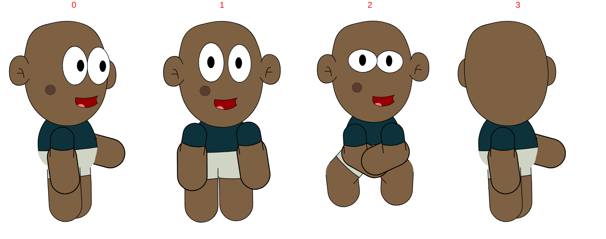
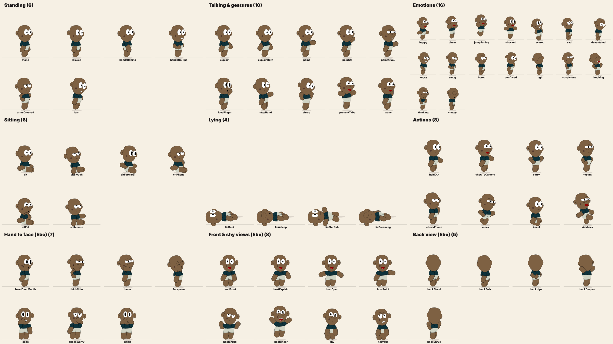

# Cast Bible

**Main character: Ebo.** Supporting cast: Mica, Obuor, Ama, Christy.


## Animation house rules

1. **Snappy, pose-to-pose motion.** Each move is a 2–3 frame snap with a small overshoot, a 1–2 frame settle, then a dead-still hold. Use anticipation before big moves.
2. **Translation and rotation only. Never animate scale** (no squash and stretch, no scale tweens). Any "squash" feeling comes from position dips and rotation. The one exception is the **camera**: it can pan, track, whip-pan and zoom (push-in or pull-out). Characters and props still never scale; only the frame does.
   **Plan every shot before animating** (`episodes/_template/shotlist.md`), and get the shot list and storyboard approved first. **Plan the camera per scene:** an establishing wide, then close-ups and extreme close-ups on faces and props, two-shots, reaction cut-ins. Use slow push-ins for emphasis, pull-outs to reveal, whip-pans between characters, snap-zooms for jokes, and tracking shots that follow a walk or run. Use `camera()` in `src/series/kit.tsx`.
3. **Expressions and mouths are frame swaps** on the eye and mouth symbols, timed to land on the snap frames.
4. **Props are drawn in a hand-drawn style:** slightly wavering lines and a light crayon grain (`src/handDrawn.tsx`). The waver never changes between frames, so nothing shimmers. See `sheets/hand-drawn-props-before-after.png`.
5. **Backgrounds and props are kept separate.** The set (walls, furniture, plants, signs) is the background; anything that's handled, moved or counted is a prop (`src/prop.tsx`). In the Animate file the set goes on the **Background** layer and props get their own **Props** / **Props front** layers, all as editable vector symbols (the sets are also saved as `.svg` files). A set never draws a prop.
6. **No lesson numbers.** Ebo never says "Lesson one: …". He goes straight to each point, and the card on screen shows just its title.
7. **Few infographics.** Show a point by having the cast act it out. Keep on-screen text to titles, chapter cards and the odd speech bubble, not stat cards, charts or check lists.
8. **Only characters and props move.** No decorative effects: no cobwebs, spiders, tumbleweeds, money rain, confetti, coin bursts, glow rays, smoke or sparks, impact bursts, camera shake, or animated backgrounds. Backgrounds and plants stay still. Text graphics are fine.

## Shared rig (all five characters)

Every character uses the same layer-parented rig with the same 16 layer names, so any animation written for one can be reused on the others.

```
waist (root)
├── torso
│   ├── head ── eye_1 / pupil_1, eye_2 / pupil_2, mouth, ear_1, ear_2
│   ├── hand_top_1 ── hand_down_1_
│   └── hand_top_2 ── hand_down_2      (the raised / waving arm)
├── leg_top_1 ── leg_down_1_
└── leg_top_2 ── leg_down_2
```

Expressions and mouth shapes are frame swaps on graphic symbols set to "single frame". The frame numbers below are 0-based, matching Animate's **First frame** field.

---

## EBO (main character)

- **File:** `masters/Ebo.fla` (new master, Oct 2026; the earlier one is in git history). **Symbol:** `Ebo`. **Stage:** 1280×720 at 24 fps.
- **Design:** dark teal T-shirt, grey shorts, big ears, cheek mole, and big white eyes with separate pupils.
- **Four views.** The `Ebo` symbol has 4 keyframes, and each is a view (`pose.view`):

  | view | what | notes |
  |---|---|---|
  | 0 | ¾ (default) | right arm drawn behind the head |
  | 1 | straight to camera | both arms in front; host shots |
  | 2 | front, hands in, legs apart | shy / nervous |
  | 3 | back | back of the head, no face; walking off, sulking |

  
- **In-front arm.** The layers `hand_top_2_front` / `hand_down_2_front` sit above the head. `pose.armFront: true` draws the right arm there in any view, which makes hand-to-face poses possible (the `hands` group). The arms are short, so the hand reaches the mouth, chin or cheek, but not the eyes.
- **Eyes** (`eye_1`, `eye_2` → `eye 1`, 14 frames) with **pupils** on top (`pupil_1`, `pupil_2` → `pupil 1`, 8 frames). Pupils move with `lookX` / `lookY`.
  - Eye shapes: 0 tall oval · 1 / 3 wide oval · 2 closed line · 4 small oval · 5 lid line (glare) · 6 tilted · 7 flat half-lid · 8 `><` squeeze · 9 lower lid (happy) · 10 upper lid (droopy) · 11 both lids (squint) · 12 closed lid · 13 empty (back view)
  - Pupils: 0 tall oval · 1 / 2 round · 3 flat-top (for upper lids) · 4 flat-bottom (for lower lids) · 5 / 6 side · 7 none
  - How the show's eye names map to [eye, pupil]: open = the view's own · wide 0,0 · happy 9,4 · half 7,3 · sad 10,3 · squint 11,2 · angry 5,1 · suspicious 11,5 · tired 10,3 · squeeze 8,7 · closed / blink 12,7. See `sheets/ebo-eyes.png`.
- **Mouth** (`mouth`, 15 frames): 0 squiggle · 1 open smile · 2 teeth grin · 3 talk with teeth · 4 laugh · 5 small o · 6 smile line · 7 small grit · 8 open · 9 gritted · 10 talk wide · 11 shout · 12 small o (low) · 13 frown · 14 smirk. See `sheets/ebo-mouths.png`.
  - Lip sync: rest 6 · wide 3/1 · mid 10/8 · round 5 (alternating every 4 frames so speech doesn't look stiff).
- **New eye names** angry, suspicious, tired and squeeze, and **new mouth names** teeth, laugh and grimace, work on everyone: rigs without those drawings fall back to the nearest ones they have.
- **Cycles** play in view 0.
- **Voice:** the file has no voice track (the old master had the Dan test read).

## MICA

- **File:** `masters/mica_drip.fla`. **Symbol:** `Obuor`. This is a renamed copy, so the symbol name doesn't match the character. **Stage:** **1080×1920 (vertical)** at 24 fps.
- **Design:** blue beanie with a patch, lavender T-shirt, blue denim shorts.
- **Eyes** (`eye_1`, `eye_2` → `pupil 11`, 5 frames):
  - 0 neutral
  - 1 wide/round
  - 2 closed / happy curve
  - 3 surprised (irregular)
  - 4 blank
- **Mouth** (`mouth&#032`, 4 frames):
  - 0 smile
  - 1 small flat open
  - 2 tall O
  - 3 big open
- **Outfit swaps:**
  - `torso` 0 shirt, 1 shirtless
  - `hand_top_1` / `hand_top_2` 0 sleeve, 1 bare arm
  - `leg_top_2` has 2 frames

## OBUOR

- **File:** `masters/obuor.fla`. **Symbol:** `Obuor`. **Stage:** 1280×720 at **12 fps**. This is the only file at 12 fps, so it's worth deciding on one frame rate for the show.
- **Design:** bald, orange T-shirt, brown shorts. No outlines (flat colour style).
- **Eyes** (`pupil 11`, 5 frames) are the same set as Mica's: 0 neutral, 1 wide, 2 closed, 3 surprised, 4 blank.
- **Mouth** (`mouth copy`, 4 frames) is also the same set as Mica's: 0 smile, 1 flat open, 2 O, 3 big open.
- The library also contains an unused `Etoo` rig.

## AMA

- **File:** `masters/Ama_pretty.fla`. **Symbol:** `Ama port`. **Stage:** 1280×720 at 24 fps.
- **Design:** swept dark hair with highlights, orange top, brown ruffled skirt, earring.
- **Eyes** (`eye 11` / `eye 12`, 5 frames):
  - 0 neutral
  - 1 wide/round
  - 2 closed / happy curve
  - 3 surprised
  - 4 blank
- **Mouth** (4 frames):
  - 0 rest
  - 1 open wide
  - 2 open mid
  - 3 O
- **Outfit and hair swaps:**
  - `head` 0 dark hair, 1 red hair, 2 red head-wrap (back view)
  - `torso` 0–2 top variants
  - `ear_1` / `ear_2` 0 front, 1 back
  - Arm and forearm variants
- **Skirt:** `waist` has a **15-frame skirt animation**, so it moves on its own when the symbol is set to loop.
- The library also contains older `Ebo`, `Ama` and `Christy` rigs.

## CHRISTY

- **File:** `masters/christy.fla`. **Symbol:** `Christy`. **Stage:** 1280×720 at 24 fps.
- **Design:** bright blue swept hair, dark teal top, translucent pale skirt.
- **Eyes** (`eye 1` / `eye 2`, 7 frames): the same set as Ebo's (neutral, unimpressed, closed, …, wide, sad, squint).
- **Mouth** (4 frames): 0 rest, 1 open wide, 2 open mid, 3 O.

---

## Pose library (`src/cast/poses.ts`)

There are 70 named poses in nine groups, tuned for this rig (big head, short limbs). All of them use rotation and translation only. Use them as `{...POSE.explain, eyes: 'happy'}`. Faces can be overridden per shot.



| Group | Poses |
|---|---|
| Standing | stand, relaxed, handsBehind, handsOnHips, armsCrossed, lean |
| Talking & gestures | explain, explainBoth, point, pointUp, pointAtYou, ideaFinger, stopHand, shrug, presentTaDa, wave |
| Emotions | happy, cheer, jumpForJoy, shocked, scared, sad, devastated, angry, smug, bored, confused, ugh, suspicious, laughing, thinking, sleepy |
| Sitting | sit, sitSlouch, sitForward, sitPhone, sitEat, sitRemote (place on the seat top) |
| Lying | lieBack, lieAsleep, lieStarfish, lieDreaming (place `LIE_Y` above the floor or mattress) |
| Actions | holdOut, showToCamera, carry, typing, checkPhone, sneak, kneel, kickback |
| Hand to face (Ebo) | handOverMouth, thinkChin, hmm, facepalm, oops, cheekWorry, panic |
| Front & shy (Ebo) | hostFront, hostExplain, hostOpen, hostPoint, hostShrug, hostCheer, shy, nervous |
| Back view (Ebo) | backStand, backSulk, backHips, backDespair, backShrug |

How the rig moves (`sheets/poses-calibration.png`, `sheets/ebo-views.png`):
- **Arms:** 0 means hanging, 90 straight out, about 135 up and out. Past about 140, the hand hides behind the head (unless the arm is in front).
- **Elbows:** a positive angle bends the forearm up and in, toward the chest. A negative angle bends it down and out.
- **Hand to face (Ebo only):** with `armFront: true`, armR [180, 0] covers the mouth, [175, 40] is a hand on the chin, and [170, 80] is the chin from the side. In view 1, [170, 60] puts a hand on the cheek; on both arms it's the hands-on-cheeks panic. On other characters the head is still drawn over the arms, so these poses show the arm behind the head.
- **Views (Ebo only):** `view: 1 | 2 | 3`. Other rigs ignore it.
- **Expression comes mostly from the body:** `lift` (sink or jump), `tilt` (lean) and `headTilt` do most of the work, plus the eye and mouth swaps.

Each group has its own sheet composition, `PoseSheet-<group>`, which renders it for any character. `Ebo-Views`, `Ebo-Eyes` and `Ebo-Mouths` are the review sheets for Ebo's new master.

## Walk and run cycles (`cycles/`)

These are your own cycles, copied onto the current characters. Only the body motion is copied: limb, torso and head rotation and position, frame by frame. Faces, outfits and drawings stay each character's own. Your original files are in `cycles/source/`.

| Character | Cycles | Animate file |
|---|---|---|
| Ebo | run (8 frames), fast walk (5, Obuor's, retargeted), both re-fitted to the new master | `cycles/Ebo_cycles.fla` |
| Christy | walk (8), fast walk (5) | `cycles/Christy_cycles.fla` |
| Obuor | fast walk (5) | `cycles/Obuor_cycles.fla` |
| Mica | fast walk (5), from `konka_drip_fast_walk.fla` | `cycles/Mica_cycles.fla` |

- All cycles are held keys at 24 fps and loop in place. A shot moves the character across the set with translation only.
- In each file, the cycles are the symbols `<Name>/<Name> walk` (or `fast walk`, `run`), next to an untouched copy of the master rig.
- In the show code, use `<RigCharacter cycle="walk" … />`. The pose still drives the face, tilt and lift.
- Ebo's fast walk is Obuor's, retargeted with `export_cycle.py … REST_XFL REST_SYMBOL`. Each part gets Obuor's movement away from Obuor's standing pose, added to Ebo's own standing pose, so Ebo keeps his proportions.
- Ama has no cycle yet.
- To add a cycle, run `tools/export_cycle.py` (copies the motion onto a master) and `tools/build_cycle_fla.py` (builds the Animate file).
- If a part was redrawn since the cycle was made, like Mica's head versus the old Konka head, it gets the cycle's movement relative to the cycle's first frame instead of the old position.

## Lip-sync mapping (4-shape mouths)

| Sound | Ebo / Ama / Christy | Mica / Obuor |
|---|---|---|
| silence / M B P | 0 | 0 (smile) or 1 |
| A, I (open) | 1 | 3 |
| E, consonants | 2 | 1 |
| O, U, W | 3 | 2 |

## Things to decide

1. **Frame rate:** Obuor's file is 12 fps and the others are 24 fps.
2. **Format:** Mica's file is vertical (1080×1920) and the others are 16:9.
3. **Names:** Mica's symbol is called `Obuor`. Rename it to `Mica` in Animate to avoid mix-ups when characters share a scene file.

## Tools (`tools/`)

- `fla_extract.py`: unpacks a `.fla`. It handles the unusual zips Animate writes.
- `xfl.py` and `render_any.py`: render any timeline or symbol to SVG/PNG, including layer parenting and classic tweens.
- `swap_sheets.py`: builds the expression contact sheets in `sheets/`.
- `ebo_animate.py`: the snappy pose-to-pose animator that writes classic tweens back into a `.fla`. It only accepts rotation and translation, and any attempt to animate scale fails with an error. It was written for the earlier Ebo design.
