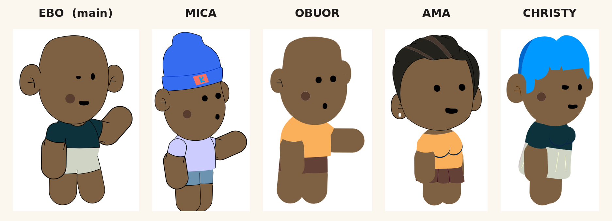

# Cast Bible

**Main character: Ebo.** Supporting cast: Mica, Obuor, Ama, Christy.



## Animation house rules

1. **Snappy, pose-to-pose motion.** Each move is a 2–3 frame snap with a small overshoot, a 1–2 frame settle, then a dead-still hold. Use anticipation before big moves.
2. **Translation and rotation only. Never animate scale** (no squash and stretch, no scale tweens). Any "squash" feeling comes from position dips and rotation.
3. **Expressions and mouths are frame swaps** on the eye and mouth symbols, timed to land on the snap frames.
4. **Props are drawn in a hand-drawn style:** slightly wavering lines and a light crayon grain (`src/handDrawn.tsx`). The waver never changes between frames, so nothing shimmers. See `sheets/hand-drawn-props-before-after.png`.
5. **Only characters and props move.** No decorative effects: no cobwebs, spiders, tumbleweeds, money rain, confetti, coin bursts, glow rays, smoke or sparks, impact bursts, camera shake, or animated backgrounds. Backgrounds and plants stay still. Text graphics are fine.

## Shared rig (all five characters)

Every character uses the same layer-parented rig with the same 16 layer names, so any animation written for one can be reused on the others.

```
waist (root)
├── torso
│   ├── head ── eye_1 / pupil_1, eye_2 / pupil_2, mouth, ear_1, ear_2
│   ├── hand_top_1 ── hand_down_1_
│   └── hand_top_2 ── hand_down_2      (the raised / waving arm)
├── leg_top_1 ── leg_down_1_
└── leg_top_2 ── leg_down_2
```

Expressions and mouth shapes are frame swaps on graphic symbols set to "single frame". The frame numbers below are 0-based, matching Animate's **First frame** field.

---

## EBO (main character)

- **File:** `masters/Ebo.fla`. **Symbol:** `Ebo`. **Stage:** 1280×720 at 24 fps.
- **Design:** dark teal T-shirt, grey shorts, big ears, black dot eyes and no eye whites (the redesign). Cheek mole.
- **Voice:** the file includes an ElevenLabs voice track ("Dan – calm & friendly"), 55.7 s long. The main timeline runs 1,340 frames to match it. The `Ebo` symbol itself isn't animated yet.
- **Eye layers** (`pupil_1`, `pupil_2` → symbol `pupil 1`, 7 frames):
  - 0 neutral (tall oval)
  - 1 unimpressed (flat top)
  - 2 closed / blink
  - 3 same as 1
  - 4 wide (surprised)
  - 5 sad/angry (slanted top)
  - 6 squint
- **Default look:** left eye 1 and right eye 0, a skeptical expression.
- **Mouth** (`mouth`, 4 frames):
  - 0 closed / rest
  - 1 open wide (A/I)
  - 2 open mid (E)
  - 3 tall O (O/U)
- **Other swaps:** the upper arms and thighs have 2 frames each (outline variants).

## MICA

- **File:** `masters/mica_drip.fla`. **Symbol:** `Obuor`. This is a renamed copy, so the symbol name doesn't match the character. **Stage:** **1080×1920 (vertical)** at 24 fps.
- **Design:** blue beanie with a patch, lavender T-shirt, blue denim shorts.
- **Eyes** (`eye_1`, `eye_2` → `pupil 11`, 5 frames):
  - 0 neutral
  - 1 wide/round
  - 2 closed / happy curve
  - 3 surprised (irregular)
  - 4 blank
- **Mouth** (`mouth&#032`, 4 frames):
  - 0 smile
  - 1 small flat open
  - 2 tall O
  - 3 big open
- **Outfit swaps:**
  - `torso` 0 shirt, 1 shirtless
  - `hand_top_1` / `hand_top_2` 0 sleeve, 1 bare arm
  - `leg_top_2` has 2 frames

## OBUOR

- **File:** `masters/obuor.fla`. **Symbol:** `Obuor`. **Stage:** 1280×720 at **12 fps**. This is the only file at 12 fps, so it's worth deciding on one frame rate for the show.
- **Design:** bald, orange T-shirt, brown shorts. No outlines (flat colour style).
- **Eyes** (`pupil 11`, 5 frames) are the same set as Mica's: 0 neutral, 1 wide, 2 closed, 3 surprised, 4 blank.
- **Mouth** (`mouth copy`, 4 frames) is also the same set as Mica's: 0 smile, 1 flat open, 2 O, 3 big open.
- The library also contains an unused `Etoo` rig.

## AMA

- **File:** `masters/Ama_pretty.fla`. **Symbol:** `Ama port`. **Stage:** 1280×720 at 24 fps.
- **Design:** swept dark hair with highlights, orange top, brown ruffled skirt, earring.
- **Eyes** (`eye 11` / `eye 12`, 5 frames):
  - 0 neutral
  - 1 wide/round
  - 2 closed / happy curve
  - 3 surprised
  - 4 blank
- **Mouth** (4 frames):
  - 0 rest
  - 1 open wide
  - 2 open mid
  - 3 O
- **Outfit and hair swaps:**
  - `head` 0 dark hair, 1 red hair, 2 red head-wrap (back view)
  - `torso` 0–2 top variants
  - `ear_1` / `ear_2` 0 front, 1 back
  - Arm and forearm variants
- **Skirt:** `waist` has a **15-frame skirt animation**, so it moves on its own when the symbol is set to loop.
- The library also contains older `Ebo`, `Ama` and `Christy` rigs.

## CHRISTY

- **File:** `masters/christy.fla`. **Symbol:** `Christy`. **Stage:** 1280×720 at 24 fps.
- **Design:** bright blue swept hair, dark teal top, translucent pale skirt.
- **Eyes** (`eye 1` / `eye 2`, 7 frames): the same set as Ebo's (neutral, unimpressed, closed, …, wide, sad, squint).
- **Mouth** (4 frames): 0 rest, 1 open wide, 2 open mid, 3 O.

---

## Lip-sync mapping (4-shape mouths)

| Sound | Ebo / Ama / Christy | Mica / Obuor |
|---|---|---|
| silence / M B P | 0 | 0 (smile) or 1 |
| A, I (open) | 1 | 3 |
| E, consonants | 2 | 1 |
| O, U, W | 3 | 2 |

## Things to decide

1. **Frame rate:** Obuor's file is 12 fps and the others are 24 fps.
2. **Format:** Mica's file is vertical (1080×1920) and the others are 16:9.
3. **Names:** Mica's symbol is called `Obuor`. Rename it to `Mica` in Animate to avoid mix-ups when characters share a scene file.

## Tools (`tools/`)

- `fla_extract.py`: unpacks a `.fla`. It handles the unusual zips Animate writes.
- `xfl.py` and `render_any.py`: render any timeline or symbol to SVG/PNG, including layer parenting and classic tweens.
- `swap_sheets.py`: builds the expression contact sheets in `sheets/`.
- `ebo_animate.py`: the snappy pose-to-pose animator that writes classic tweens back into a `.fla`. It only accepts rotation and translation, and any attempt to animate scale fails with an error. It was written for the earlier Ebo design.
