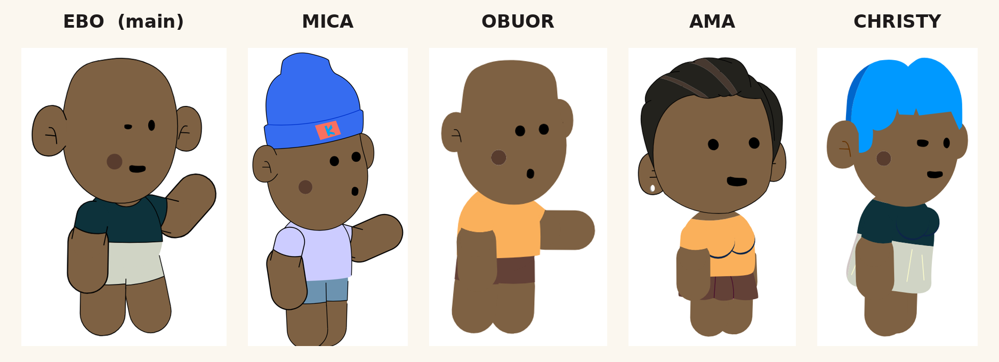
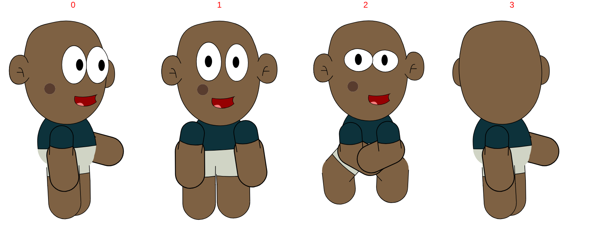
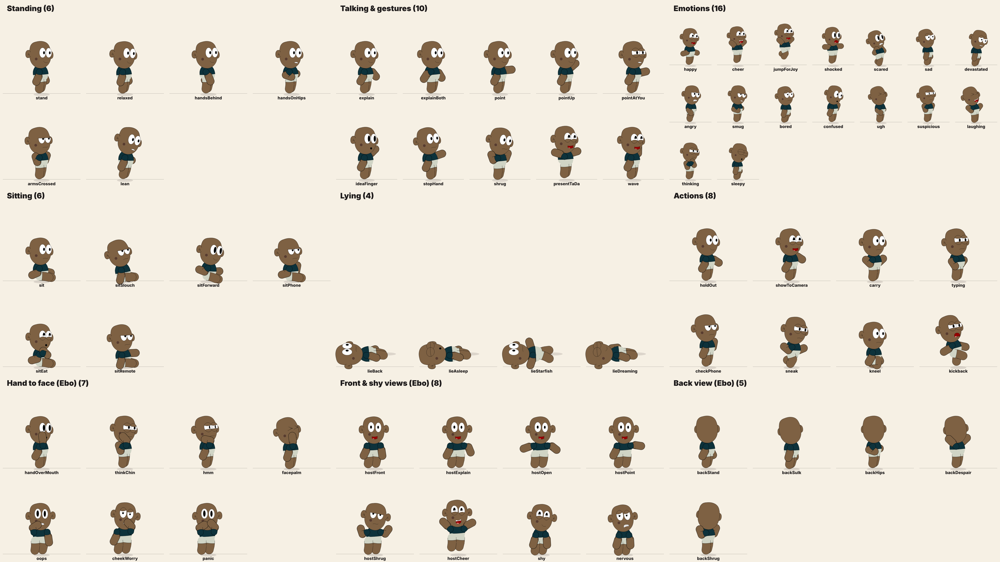

# Cast Bible

**Main character: Ebo.** Supporting cast: Mica, Obuor, Ama, Christy.



## Animation house rules

1. **Snappy, pose-to-pose motion.** Each move is a 2–3 frame snap with a small overshoot, a 1–2 frame settle, then a dead-still hold. Use anticipation before big moves.
2. **Translation and rotation only. Never animate scale** (no squash and stretch, no scale tweens). Any "squash" feeling comes from position dips and rotation. The one exception is the **camera**: it can pan, track, whip-pan and zoom (push-in or pull-out). Characters and props still never scale; only the frame does.
   **Plan every shot before animating** (`episodes/_template/shotlist.md`), and get the shot list and storyboard approved first. **Plan the camera per scene:** an establishing wide, then close-ups and extreme close-ups on faces and props, two-shots, reaction cut-ins. Use slow push-ins for emphasis, pull-outs to reveal, whip-pans between characters, snap-zooms for jokes, and tracking shots that follow a walk or run. Use `camera()` in `src/series/kit.tsx`. **The Animate files carry no camera:** the export lays every frame on the full stage at zoom 1, and the animator adds the camera in Animate. The camera only shapes the rendered video and the storyboard.
3. **Expressions and mouths are frame swaps** on the eye and mouth symbols, timed to land on the snap frames.
4. **Props are drawn in a hand-drawn style:** slightly wavering lines and a light crayon grain (`src/handDrawn.tsx`). The waver never changes between frames, so nothing shimmers. See `sheets/hand-drawn-props-before-after.png`.
5. **Backgrounds and props are kept separate.** The set (walls, furniture, plants, signs) is the background; anything that's handled, moved or counted is a prop (`src/prop.tsx`). In the Animate file the set goes on the **Background** layer and props get their own **Props** / **Props front** layers, all as editable vector symbols (the sets are also saved as `.svg` files). A set never draws a prop.
6. **No lesson numbers.** Ebo never says "Lesson one: …". He goes straight to each point, and the card on screen shows just its title.
7. **Few infographics.** Show a point by having the cast act it out. Keep on-screen text to titles, chapter cards and the odd speech bubble, not stat cards, charts or check lists.
8. **Only characters and props move.** No decorative effects: no cobwebs, spiders, tumbleweeds, money rain, confetti, coin bursts, glow rays, smoke or sparks, impact bursts, camera shake, or animated backgrounds. Backgrounds and plants stay still. Text graphics are fine.
9. **Organic, not busy** (reference: an animated YouTube storytime the user loves). Most of the video is the character acting on a **plain soft backdrop**: one flat colour or a gentle gradient, no room, furniture or floor line. The camera punches in and out on that backdrop (wide → close-up on the face for the reaction) and the **acting carries it**: held poses with expression and mouth changes, the odd small hop. Keep **one recurring gag prop at most** per episode; show other props only when the joke needs them. Cut to a real location only for a quick acted-out bit, then come back. Text is rare and casual (a handwritten-style word or a short list that builds up), never a stat card or chart.
10. **How characters handle props** (from the same reference):
   - **Props live in the world, and the character goes to them.** The laptop sits on the desk; he sits down at it, types, then slams it shut or shoves it away. Act on the prop (type, slam, push, toss, drop) rather than holding it up to the camera.
   - **The screen faces whoever is using it.** From the side or behind we see the back or edge of the laptop or phone; we only see the screen in an insert.
   - **An insert is its own drawing, not a zoom.** Draw the object big and filling the frame, slightly tilted, often with a big hand in it (a finger tapping or scrolling the phone). Then cut back to the wide shot.
   - **The hand is on the prop.** Fingers overlap the object (the hand draws over it), and the object turns with the hand instead of floating upright beside it.
   - **Held props are rare and brief.** A prop is picked up for the beat that needs it, then put down or thrown.
   - **Props feel tangible.** Give the character something to handle in most acted shots (toss a ball, curl a dumbbell, hammer, bite, chalk a line, tick a box), and let props react physically: things that are dropped fall with gravity and bounce once, things that are hit jolt, things that are swatted fly off. Only translation and rotation (house rule 2).
11. **The camera holds still.** Camera animation was too much: every shot is one framing and the cut does the work (wide, then a cut to the close-up). A planned reveal, zoom, whip or pan becomes a straight cut to where it was going. This overrides the camera planning in rule 2.
12. **Ebo stands.** No sitting on the floor, squatting or kneeling poses: he reads, works and eats standing up, and anything he works on goes on a stand (a crate, a desk) at hand height. The exceptions are a real seat (a couch or chair in the set) and lying down when the joke needs it.
13. **Arms stay straight or gently bent.** The rigs have only an upper arm and a forearm, with no hand, palm or fingers, so a deep elbow bend (hands on hips, folded arms, a tight curl, robot arms) reads as a broken limb. Keep the elbow within about ±40° and act with the shoulder: reach, raise, point, swing. In code, pass Ebo's poses through `gentle()` (`src/cast/poses.ts`).
14. **Ebo faces the camera.** No side-on (¾) poses: he's drawn in his front view, or his back view when we're behind him. His front-view arms draw over his face, so they stop at shoulder height, and raised arms go out to the sides. Props sit where he can reach them facing us. The one exception is the push-up, which only reads from the side. In code, use `frontOn()` (`src/cast/poses.ts`).
15. **Hands talk.** When a character talks to us, the hands gesture on the stressed words: open palms, a one-hand explain, a raised hand, a side point, a small shrug, or back to the shot's own pose. The gestures snap pose to pose and each holds at least about half a second. The shot opens on its planned pose. Shots where the character is acting with a prop keep their own arm moves. In code, use `talkGesture()` (`src/series/kit.tsx`). **Ep4 gestures on the beat** with `beatGesture()`:
   - **When:** on the stressed syllables of the voice, which are the loudness peaks rising out of a dip.
   - **What:** the gesture matches the word on the beat: open palms on "you", a raised hand on numbers, a shrug on "maybe" or "just", a point on "this" or "that", a flat stop on "never". Other words alternate between gestures.
   - **How:** each change follows rule 1. One anticipation frame, a 2-frame snap with an overshoot that peaks on the beat, a settle, then dead still.

16. **No hands: the arm lands on him (contact poses).** The user's call after the handless-style reference (Nov 2026): the rigs keep their hand-less arms, and a missing hand reads as there when the end of the arm touches something. So for reactions, use the contact poses in `CONTACT` (`src/cast/poses.ts`): arms crossed, hand on chin, "hmm", thinking, facepalm, hand over mouth, a worried cheek, both cheeks. They're marked `contact: true`, which exempts them (only them) from rule 13's elbow limit and rule 14's front-arm limit. A held prop sits right at the arm's end. Hands on hips doesn't read in Ebo's front view (the forearms fold over his belly), so don't use it. The drawn hand set (`src/cast/hands.tsx`) is shelved. To get closer to the reference, the forearm ends in the masters should be rounded off (a rig change in Animate).
17. **Give the prop the room.** After the user's reference video (Nov 2026, Ep7 v2): what Ebo is talking about is drawn big and lands on its word, with Ebo small at the bottom of the frame; close shots are for the punches, and a prop can take the whole frame with his head in the corner. Vary the size from shot to shot (wide, close, insert); never the same framing twice in a row. Each section can shift the backdrop shade a little. The camera still never moves (rule 11): every change is a cut.
18. **Never frozen; a fresh face on each punch.** The lively pass (Ep7 test, `EboEp07Lively`): a held reaction face on each punchline (eyes, mouth, head tilt; Ebo's rig has no brows), a slow lean and shoulder shift, glances while talking, a blink on every cut, his eyes going to what he points at or what just landed, props that rock once and settle when they land, and side characters (the want) that blink and sway. Rotation and movement only (rule 2).
## Shared rig (all five characters)

Every character uses the same layer-parented rig with the same 16 layer names, so any animation written for one can be reused on the others.

```
waist (root)
├── torso
│   ├── head ── eye_1 / pupil_1, eye_2 / pupil_2, mouth, ear_1, ear_2
│   ├── hand_top_1 ── hand_down_1_
│   └── hand_top_2 ── hand_down_2      (the raised / waving arm)
├── leg_top_1 ── leg_down_1_
└── leg_top_2 ── leg_down_2
```

Expressions and mouth shapes are frame swaps on graphic symbols set to "single frame". The frame numbers below are 0-based, matching Animate's **First frame** field.

---

## EBO (main character)

- **File:** `masters/Ebo.fla` (new master, Oct 2026; the earlier one is in git history). **Symbol:** `Ebo`. **Stage:** 1280×720 at 24 fps.
- **Design:** dark teal T-shirt, grey shorts, big ears, cheek mole, and big white eyes with separate pupils.
- **Hand props are part of the rig.** The graphic symbol `Ebo_HandProps` holds one prop per frame, and each frame is labelled with the prop's name. Frame 0 is an empty hand. The frames are:
  - **Everyday:** `phone_back`, `phone_scroll`, `phone_gallery`, `remote`, `chips`, `cereal`, `slice`, `slice_bitten`, `notebook_0` to `notebook_4`, `letter_rejected`, `letter_cv`, `sticky_goal`, `sticky_appidea`.
  - **Tools:** `hammer`, `dumbbell`, `brush`, `marker`, `chalk`.

  It sits on three layers at the top of the rig, each parented to a forearm: `prop_R` (the right arm behind the head), `prop_R_front` (the right arm in front) and `prop_L` (the left arm). In Animate, set the instance to Looping: Single frame, First = the prop's frame. The prop then rides the forearm when you re-pose the arm. The forearms are parent layers for this, with no other change.

  In code, a held prop is still written as Ebo's child, e.g. `<Remote rotate={-20} />`, or as `holdL` for the left hand. `RigCharacter` draws it through the rig layer when the prop is in `src/cast/handProps.tsx`.

  To add a prop, append it there, then rebuild the master:
  1. `node scripts/hand-props/run.mjs out/hand-props/hand-props.json`
  2. `python3 -I tools/add_hand_props.py <original master> out/hand-props/hand-props.json masters/Ebo.fla <work dir>`
  3. `tools/export_rig.py <work dir> Ebo src/cast/data/ebo.json`
- **Four views.** The `Ebo` symbol has 4 keyframes, and each is a view (`pose.view`):

  | view | what | notes |
  |---|---|---|
  | 0 | ¾ (default) | right arm drawn behind the head |
  | 1 | straight to camera | both arms in front; host shots |
  | 2 | front, hands in, legs apart | shy / nervous |
  | 3 | back | back of the head, no face; walking off, sulking |

  
- **In-front arm.** The layers `hand_top_2_front` / `hand_down_2_front` sit above the head. `pose.armFront: true` draws the right arm there in any view, which makes hand-to-face poses possible (the `hands` group). The arms are short, so the hand reaches the mouth, chin or cheek, but not the eyes.
- **Eyes** (`eye_1`, `eye_2` → `eye 1`, 14 frames) with **pupils** on top (`pupil_1`, `pupil_2` → `pupil 1`, 8 frames). Pupils move with `lookX` / `lookY`.
  - Eye shapes: 0 tall oval · 1 / 3 wide oval · 2 closed line · 4 small oval · 5 lid line (glare) · 6 tilted · 7 flat half-lid · 8 `><` squeeze · 9 lower lid (happy) · 10 upper lid (droopy) · 11 both lids (squint) · 12 closed lid · 13 empty (back view)
  - Pupils: 0 tall oval · 1 / 2 round · 3 flat-top (for upper lids) · 4 flat-bottom (for lower lids) · 5 / 6 side · 7 none
  - How the show's eye names map to [eye, pupil]: open = the view's own · wide 0,0 · happy 9,4 · half 7,3 · sad 10,3 · squint 11,2 · angry 5,1 · suspicious 11,5 · tired 10,3 · squeeze 8,7 · closed / blink 12,7. See `sheets/ebo-eyes.png`.
- **Mouth** (`mouth`, 15 frames): 0 squiggle · 1 open smile · 2 teeth grin · 3 talk with teeth · 4 laugh · 5 small o · 6 smile line · 7 small grit · 8 open frown · 9 gritted · 10 open, downturned · 11 big open, downturned · 12 small o (low) · 13 frown · 14 grimace. See `sheets/ebo-mouths.png`.
  - The mouths come in two moods. Happy / normal: 1, 2, 3, 4, 5, 6, 12. Sad / upset: 7, 8, 9, 10, 11, 13, 14. Neutral: 0. Never mix them in one expression.
  - Lip sync follows the shot's expression (the pose's mouth): happy talks with rest 6 · wide 3/1 · mid 1/3 · round 5; upset (frown, wobbly, grimace, scream, o) with rest 13 · wide 11/10 · mid 8/10 · round 12; flat with rest 0 · wide 3/1 · mid 3/12 · round 12. Shapes alternate every 4 frames so speech doesn't look stiff.
- **New eye names** angry, suspicious, tired and squeeze, and **new mouth names** teeth, laugh and grimace, work on everyone: rigs without those drawings fall back to the nearest ones they have.
- **Cycles** play in view 0.
- **Voice:** the file has no voice track (the old master had the Dan test read).

## MICA

- **File:** `masters/mica_drip.fla`. **Symbol:** `Obuor`. This is a renamed copy, so the symbol name doesn't match the character. **Stage:** **1080×1920 (vertical)** at 24 fps.
- **Design:** blue beanie with a patch, lavender T-shirt, blue denim shorts.
- **Eyes** (`eye_1`, `eye_2` → `pupil 11`, 5 frames):
  - 0 neutral
  - 1 wide/round
  - 2 closed / happy curve
  - 3 surprised (irregular)
  - 4 blank
- **Mouth** (`mouth&#032`, 4 frames):
  - 0 smile
  - 1 small flat open
  - 2 tall O
  - 3 big open
- **Outfit swaps:**
  - `torso` 0 shirt, 1 shirtless
  - `hand_top_1` / `hand_top_2` 0 sleeve, 1 bare arm
  - `leg_top_2` has 2 frames

## OBUOR

- **File:** `masters/obuor.fla`. **Symbol:** `Obuor`. **Stage:** 1280×720 at **12 fps**. This is the only file at 12 fps, so it's worth deciding on one frame rate for the show.
- **Design:** bald, orange T-shirt, brown shorts. No outlines (flat colour style).
- **Eyes** (`pupil 11`, 5 frames) are the same set as Mica's: 0 neutral, 1 wide, 2 closed, 3 surprised, 4 blank.
- **Mouth** (`mouth copy`, 4 frames) is also the same set as Mica's: 0 smile, 1 flat open, 2 O, 3 big open.
- The library also contains an unused `Etoo` rig.

## AMA

- **File:** `masters/Ama.fla` (new master, Nov 2026; the earlier `Ama_pretty.fla` is in git history). **Symbol:** `Ama`.
- **Design:** pink bucket hat, dark teal top, yellow skirt.
- **Built on Ebo's part set.** She has the same layer names and parenting as Ebo, the same 15 mouths in the same order, and Ebo's eye and pupil frames (13 eye shapes). She shares his face mapping and lip-sync mood sets in `castConfig.ts`.
- **One view (¾).** The `Ama` symbol's keys after frame 0 are a test animation. The rig is exported from frame 0 (her rest pose) from a copy trimmed to that frame.
- **Export:** trim `Ama.xml` to each layer's first keyframe, then `tools/export_rig.py <dir> Ama src/cast/data/ama.json`, then `node scripts/measure-rigs.mjs`.

## AMA PRETTY

- **File:** `masters/Ama_pretty.fla` (new version, Nov 2026). **Symbol:** `Ama port`. **Cast id:** `pretty`.
- **Design:** swept dark hair, olive top, peach skirt, earring.
- **Built on Ebo's part set, like Ama.** She shares Ama's face mapping and lip-sync mood sets.
- **One view (¾).** The rig is exported from frame 0. A palette reference image on her `hand_top_1` layer is removed from the rig.
- **Export:** same steps as Ama, with symbol `Ama port`, output to `src/cast/data/pretty.json`.
- **First role:** Christy in Ep6.

## CHRISTY

- **File:** `masters/christy.fla`. **Symbol:** `Christy`. **Stage:** 1280×720 at 24 fps.
- **Design:** bright blue swept hair, dark teal top, translucent pale skirt.
- **Eyes** (`eye 1` / `eye 2`, 7 frames): the same set as Ebo's (neutral, unimpressed, closed, …, wide, sad, squint).
- **Mouth** (4 frames): 0 rest, 1 open wide, 2 open mid, 3 O.

---

## Pose library (`src/cast/poses.ts`)

There are 70 named poses in nine groups, tuned for this rig (big head, short limbs). All of them use rotation and translation only. Use them as `{...POSE.explain, eyes: 'happy'}`. Faces can be overridden per shot.



| Group | Poses |
|---|---|
| Standing | stand, relaxed, handsBehind, handsOnHips, armsCrossed, lean |
| Talking & gestures | explain, explainBoth, point, pointUp, pointAtYou, ideaFinger, stopHand, shrug, presentTaDa, wave |
| Emotions | happy, cheer, jumpForJoy, shocked, scared, sad, devastated, angry, smug, bored, confused, ugh, suspicious, laughing, thinking, sleepy |
| Sitting | sit, sitSlouch, sitForward, sitPhone, sitEat, sitRemote (place on the seat top) |
| Lying | lieBack, lieAsleep, lieStarfish, lieDreaming (place `LIE_Y` above the floor or mattress) |
| Actions | holdOut, showToCamera, carry, typing, checkPhone, sneak, kneel, kickback |
| Hand to face (Ebo) | handOverMouth, thinkChin, hmm, facepalm, oops, cheekWorry, panic |
| Front & shy (Ebo) | hostFront, hostExplain, hostOpen, hostPoint, hostShrug, hostCheer, shy, nervous |
| Back view (Ebo) | backStand, backSulk, backHips, backDespair, backShrug |

How the rig moves (`sheets/poses-calibration.png`, `sheets/ebo-views.png`):
- **Arms:** 0 means hanging, 90 straight out, about 135 up and out. Past about 140, the hand hides behind the head (unless the arm is in front).
- **Elbows:** a positive angle bends the forearm up and in, toward the chest. A negative angle bends it down and out.
- **Hand to face (Ebo only):** with `armFront: true`, armR [180, 0] covers the mouth, [175, 40] is a hand on the chin, and [170, 80] is the chin from the side. In view 1, [170, 60] puts a hand on the cheek; on both arms it's the hands-on-cheeks panic. On other characters the head is still drawn over the arms, so these poses show the arm behind the head.
- **Views (Ebo only):** `view: 1 | 2 | 3`. Other rigs ignore it.
- **Expression comes mostly from the body:** `lift` (sink or jump), `tilt` (lean) and `headTilt` do most of the work, plus the eye and mouth swaps.

Held props (`hold`):
- A prop held in the hand never mirrors when the character faces left, so text and screens stay readable.
- **Screens face whoever is looking at them.** When Ebo is using his phone, we see its back (`<BigPhone screen="back" />`) and his eyes are on it (lookX / lookY toward the hand). The screen faces us only in an insert that frames just the phone, or when he's showing it to us.

Each group has its own sheet composition, `PoseSheet-<group>`, which renders it for any character. `Ebo-Views`, `Ebo-Eyes` and `Ebo-Mouths` are the review sheets for Ebo's new master.

## Walk and run cycles (`cycles/`)

These are your own cycles, copied onto the current characters. Only the body motion is copied: limb, torso and head rotation and position, frame by frame. Faces, outfits and drawings stay each character's own. Your original files are in `cycles/source/`.

| Character | Cycles | Animate file |
|---|---|---|
| Ebo | run (8 frames), fast walk (5, Obuor's, retargeted), both re-fitted to the new master | `cycles/Ebo_cycles.fla` |
| Christy | walk (8), fast walk (5) | `cycles/Christy_cycles.fla` |
| Obuor | fast walk (5) | `cycles/Obuor_cycles.fla` |
| Mica | fast walk (5), from `konka_drip_fast_walk.fla` | `cycles/Mica_cycles.fla` |

- All cycles are held keys at 24 fps and loop in place. A shot moves the character across the set with translation only.
- In each file, the cycles are the symbols `<Name>/<Name> walk` (or `fast walk`, `run`), next to an untouched copy of the master rig.
- In the show code, use `<RigCharacter cycle="walk" … />`. The pose still drives the face, tilt and lift.
- Ebo's fast walk is Obuor's, retargeted with `export_cycle.py … REST_XFL REST_SYMBOL`. Each part gets Obuor's movement away from Obuor's standing pose, added to Ebo's own standing pose, so Ebo keeps his proportions.
- Ama has no cycle yet.
- To add a cycle, run `tools/export_cycle.py` (copies the motion onto a master) and `tools/build_cycle_fla.py` (builds the Animate file).
- If a part was redrawn since the cycle was made, like Mica's head versus the old Konka head, it gets the cycle's movement relative to the cycle's first frame instead of the old position.

## Lip-sync mapping (4-shape mouths)

| Sound | Ebo / Ama / Christy | Mica / Obuor |
|---|---|---|
| silence / M B P | 0 | 0 (smile) or 1 |
| A, I (open) | 1 | 3 |
| E, consonants | 2 | 1 |
| O, U, W | 3 | 2 |

## Things to decide

1. **Frame rate:** Obuor's file is 12 fps and the others are 24 fps.
2. **Format:** Mica's file is vertical (1080×1920) and the others are 16:9.
3. **Names:** Mica's symbol is called `Obuor`. Rename it to `Mica` in Animate to avoid mix-ups when characters share a scene file.

## Tools (`tools/`)

- `fla_extract.py`: unpacks a `.fla`. It handles the unusual zips Animate writes.
- `xfl.py` and `render_any.py`: render any timeline or symbol to SVG/PNG, including layer parenting and classic tweens.
- `swap_sheets.py`: builds the expression contact sheets in `sheets/`.
- `ebo_animate.py`: the snappy pose-to-pose animator that writes classic tweens back into a `.fla`. It only accepts rotation and translation, and any attempt to animate scale fails with an error. It was written for the earlier Ebo design.
